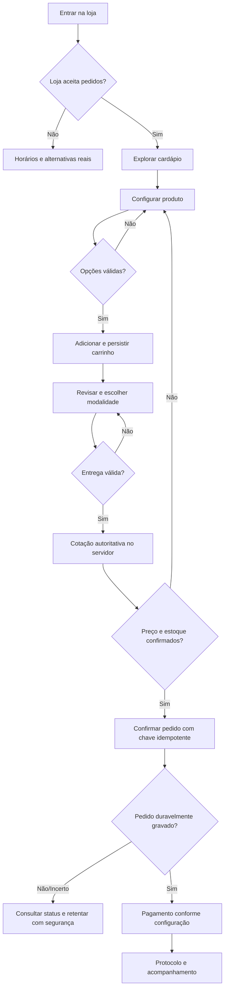

# 0WEB — Delivery storefront UX e estados (Rodada 2/8)

**Status:** `SPEC_COMPLETE / JUMA_INTERACTIVE_EVIDENCE_BLOCKED`  
**Data:** 2026-11-01  
**Escopo:** experiência pública do comprador, especialmente celulares, e QA de ponta a ponta do fluxo de pedidos.  
**Norma-mãe:** [DELIVERY_FUNCTIONAL_SYSTEM_STANDARD.md](./DELIVERY_FUNCTIONAL_SYSTEM_STANDARD.md).

## 1. Evidência, observação e limite

| Fonte | Tipo | Leitura nesta rodada | Confiança |
|---|---|---|---|
| https://pdvslim.com.br/loja/jumapizzaria | Referência principal pedida pelo responsável | A ferramenta pública devolveu `DisabledError`/conteúdo não legível; não houve screenshot nem teste JS interativo | `BLOCKED` para UI/fluxos reais |
| https://pdvslim.com.br/ | Oferta institucional do produto | A própria plataforma anuncia gestão de pedidos, KDS, delivery e balcão, estoque, caixa, papéis e multi-lojas | `VENDOR_CLAIM`, não teste |
| https://pdvslim.com.br/auth | Entrada operacional | URL informada; conteúdo não legível e sem credenciais autorizadas. Nenhum login feito | `UNVERIFIED` |
| https://pdvslim.com.br/termos | Termos públicos | Regras sobre dados do lojista e segregação; não provam implementação de controles | `DOCUMENTED_CLAIM` |
| `src/components/site/ParaisoHotDogPage.tsx` no `main` | Código 0WEB | `cart` em `useState`; `custom` em mapa por produto; `total` soma `price × quantity`; CTA usa `PortfolioCTAQuiz` e `orderContext`; não existe operação transacional no componente | `CODE_CONFIRMED` |
| `src/components/site/DlaraPizzariaPage.tsx` no `main` | Código 0WEB | CTA de contato; a própria página diz que sabores, tamanhos e valores são confirmados com equipe, sem checkout no componente | `CODE_CONFIRMED` |

**Política de verdade:** não transcrever a suposta estrutura visual, opções, valores, quantidade de produtos, checkout ou regras comerciais da Juma. As especificações abaixo são **requisitos de produto 0WEB independentes** propostos para cumprir a meta de experiência, não uma descrição da aplicação do terceiro.

### Lacunas concretas detectadas no código 0WEB

- `ParaisoHotDogPage`: ao recarregar, o carrinho local em `useState` perde a seleção; o identificador do carrinho é somente `product.id`, então múltiplas configurações de um mesmo produto não são linhas independentes.
- O seletor `extras` usa rótulos estáticos e `toggleExtra`, mas `total` considera só o `price` base: não existe preço persistido por adicional nem validação de restrições no servidor.
- O modo `entrega` altera um rótulo no resumo, mas o cálculo exibido não incorpora zona, endereço, cobertura nem frete.
- O campo visual do hero contém horário fixo e texto de status de atendimento que não derivam de uma disponibilidade em tempo real; risco de apresentar "aberto" fora de hora.
- Os botões de quantidade usam `h-10 w-10` (40 px), abaixo do alvo mínimo de 44 px definido no contrato, e extras têm alvos ainda menores.
- O CTA de continuar aciona `PortfolioCTAQuiz`, que pode registrar intenção de pedido; **isso não equivale a transação com protocolo e fila da cozinha**.
- `DlaraPizzariaPage` é intencionalmente uma landing de contato; jamais reclassificar como loja operacional sem criar os módulos reais.

**Não houve modificação em nenhuma dessas páginas nesta rodada.** Um plano de migração deve preservar marca, conteúdo, SEO e funis existentes.

## 2. IA de navegação mobile e objetivo de decisão

Ordem de informação orientada à tarefa, não cópia de silhueta de terceiro:

1. **Estado comercial**: identidade do estabelecimento, condição aberta/fechada, modalidade de retirada/entrega, tempo real/estimado rotulado como tal, cobertura disponível, preço mínimo quando existir.
2. **Encontrar**: categorias navegáveis, busca se catálogo a justificar, produto com nome, preço e fotos verídicos; selos só quando confirmados.
3. **Configurar**: página ou folha modal de produto com seleção acessível de variantes/adicionais e prévia de preço; regras de pizza apenas quando configuradas pelo lojista.
4. **Revisar**: carrinho persistente, editar item sem perder seleção, total prévio, informar o que ainda depende de endereço e entrega.
5. **Identificar e receber**: dados mínimos para execução, endereço/retirada, cobertura e taxas recalculadas, prazo quando estimado.
6. **Pagar/confirmar**: resumo final gerado pelo servidor e aviso de condições, opção de pagamento suportada, proteção contra confirmação dupla.
7. **Acompanhar**: protocolo, situação do pedido (distinta de pagamento), ações permitidas de suporte e histórico.

### Composição mobile mínima (320–430 px)

- Cabeçalho compacto que prioriza estabelecimento, status e modalidade; nenhuma hero grande deve empurrar o cardápio para muitas telas abaixo.
- Menu/categorias em faixa navegável ou tabs responsivas com rótulos completos, foco claro, sem scroll horizontal da página.
- Lista de produtos suficientemente densa para explorar sem sacrificar nome, descrição/preço, alergênicos informados e o CTA de adicionar.
- Superfície de escolha com rótulos e erros contextualizados; o botão de confirmar só habilita com grupos obrigatórios completos.
- Barra do carrinho visível e acionável quando há itens, com quantidade e subtotal; não sobrepõe CTA de acessibilidade, teclado, safe-area, rodapé ou controles do sistema operacional.
- Checkout em etapas lógicas com mínimo de digitação, auto-preenchimento assistivo e preservação de escolhas ao voltar.
- Confirmação de pedido explícita e inequívoca; **não mostrar tela de sucesso por ter aberto WhatsApp ou por ter enviado formulário de lead**.

**Desktop/tablet:** maior largura pode dividir catálogo/carrinho; são as mesmas regras e estados do mobile, sem caminhos de negócio diferentes.

## 3. Mapa de tarefas e estados visíveis

| ID | Superfície | Estado/ação | Resposta obrigatória |
|---|---|---|---|
| UX-01 | Loja | carregando | skeleton estável e status de carregamento; nunca exibir cardápio fake |
| UX-02 | Loja | aberta | modalidades efetivamente habilitadas; status baseado em dados atuais, com hora da loja |
| UX-03 | Loja | fechada | mensagem verdadeira e janela de abertura; agendamento só se suportado; não aceitar pedido imediato |
| UX-04 | Loja | sem rede | erro de conectividade e tentar novamente, sem fingir pedido |
| UX-05 | Catálogo | sem itens / categoria vazia | explicação de vazio + voltar/consultar outra categoria |
| UX-06 | Produto | indisponível | sinal de esgotado e impedir adicionar |
| UX-07 | Produto | variantes obrigatórias faltando | indicar grupo pendente e foco no erro; não fechar modal |
| UX-08 | Produto | seleção completa | mostrar total da linha e CTA "Adicionar ao carrinho" |
| UX-09 | Carrinho | vazio | CTA para escolher itens, checkout desabilitado |
| UX-10 | Carrinho | item adicionado | confirmação não intrusiva; contagem e subtotal atualizados |
| UX-11 | Carrinho | item reconfigurado | editar a mesma linha; instância de outro sabor/tamanho preservada |
| UX-12 | Carrinho | refresh/navegação | itens e opções recuperados com revalidação de preço/disponibilidade |
| UX-13 | Entrega | fora da área | impedir checkout de entrega e oferecer retirada se disponível |
| UX-14 | Entrega | endereço incompleto | erro específico, manter os campos já preenchidos |
| UX-15 | Entrega | frete calculando | estado de cálculo; exibir total anterior como provisório, nunca definitivo |
| UX-16 | Checkout | preço/estoque mudou | mostrar delta e exigir nova confirmação, sem substituir item silenciosamente |
| UX-17 | Checkout | dados inválidos | validação inline com instruções, preservar carrinho |
| UX-18 | Pagamento | aguardando Pix / cartão | status próprio e prazo definido pelo provedor; pedido só avança conforme regras da loja |
| UX-19 | Pagamento | negado/expirado | apresentar retentativa segura sem pedido duplicado |
| UX-20 | Confirmação | pedido persistido | protocolo e status iniciais fornecidos pelo backend, link de acompanhamento |
| UX-21 | Confirmação | resposta timeout após enviar | consultar idempotency key/status antes de tentar criar outro pedido |
| UX-22 | Acompanhamento | em preparo/pronto/saiu | estado e timestamp da operação, sem prometer rastreio se não existir |
| UX-23 | Acompanhamento | cancelado | mostrar estado real, motivo apropriado e situação do pagamento sem confusão |
| UX-24 | Sessão | sessão expirada | nunca perder carrinho de anônimo por redirecionamento indevido |
| UX-25 | Catálogo | mídia ausente | placeholder editorial neutro e honesto, não foto de produto falso |
| UX-26 | Promoção | cupom inválido/expirado | explicar causa, manter compra e remover desconto antecipado |

## 4. Diagramas de fluxo e responsabilidade

**Separação de responsabilidades:**
- Cliente: interações, validação de campo, cart draft/cache, **prévia** de preços.
- Servidor: itens/variantes, quotas, estoque, horário, área de entrega, cálculo, criação de pedido, transições e idempotência.
- Gateway: cobrança e conciliação assíncrona de pagamentos; nenhum "pago" por retorno de browser.
- Backoffice: aceite, preparo, despacho, cancelamento, histórico; nunca depender da presença do cliente online.

## 5. Microcópia e regras de acessibilidade

- CTA com intenção correta: "Adicionar ao carrinho", "Revisar pedido", "Confirmar pedido", "Acompanhar pedido". "Falar no WhatsApp" é ação **separada**, não confirmação de compra.
- Dinheiro sempre `R$ 00,00` com breakdown `itens + adicionais - descontos + entrega = total`; rotular estimado quando incompleto.
- Anúncios de atualização de carrinho por região `aria-live` politicamente adequada (não repetir incessantemente), focar erros e restaurar foco ao fechar modal.
- Toque mínimo 44×44 px, zoom de fonte 200%, legibilidade sob teclado virtual, contraste e `prefers-reduced-motion`; sem carrosséis automáticos como bloqueio de compra.
- Captura de endereço/telefone só quando necessária, com mascaramento que não impeça colar/preencher, rótulos visíveis, política LGPD acessível.
- Etapas não devem reiniciar ao alternar entrega/retirada, salvo campos materialmente dependentes; avisar o que será recalculado.
- Estado "fechado", "indisponível" e "ocupado" sempre vem de fonte verificável; não usar copy comercial fixa para mascarar falha técnica.

## 6. Cenários E2E de aceitação (a serem automatizados nas rodadas 4 e 7)

| Teste | Etapas | Critério de aprovação |
|---|---|---|
| E2E-D-001 | Entrar, escolher categoria, abrir produto, adicionar, revisar | seleção correta no carrinho |
| E2E-D-002 | Selecionar 2 variantes diferentes do mesmo SKU | linhas independentes + soma correta |
| E2E-D-003 | Pizza com frações e borda (loja que habilita) | regra de opção/preço da loja refletida na quote |
| E2E-D-004 | Incluir 3 itens, refresh, voltar e retomar | carrinho válido com todas as opções |
| E2E-D-005 | Alterar estoque/preço entre cart e checkout | bloqueio/aviso explícito e nova confirmação |
| E2E-D-006 | Entrega fora da área atendida | impedimento real e alternativa permitida |
| E2E-D-007 | Abrir/fechar loja enquanto cliente faz pedido | recálculo autoritativo e resposta honesta |
| E2E-D-008 | Finalizar com dinheiro na entrega, modo permitido | pedido persistido + painel atualizado + protocolo |
| E2E-D-009 | Pix teste aprovado/negado/expirado/duplicado | conciliação correta sem inventar aprovação |
| E2E-D-010 | Double tap e replay idempotente | um único pedido e um único identificador |
| E2E-D-011 | Backend aceita pedido mas resposta do navegador dá timeout | retomada pelo mesmo protocolo, sem duplicação |
| E2E-D-012 | Operador aceita, prepara, conclui; cliente acompanha | estados sincronizados e auditados |
| E2E-D-013 | Usuário de loja A tenta alterar pedido da loja B | acesso negado e evento auditado |
| E2E-D-014 | Teclado/leitor de tela/móvel 320, 390 e 430 px | jornada completa sem bloqueios e com foco correto |
| E2E-D-015 | Dispositivo com pouca rede, imagem faltante, fetch falho | estado de erro útil, nunca confirmação enganosa |
| E2E-D-016 | Cancelar pedido permitido / tentar cancelar estado proibido | autorização e transição coerentes, histórico intacto |

**Gate:** nenhum cenário pode ser marcado `PASS` antes de executar contra uma implementação real com evidência, ambiente e versão de commit identificados. Tabelas são **test cases**, não testes executados.

## 7. Artefatos necessários para benchmark interativo da Juma

A próxima inspeção efetiva da referência precisa registrar: 
- captura mobile da loja inicial (320/390/430px) e categoria; layout/topologia observada;
- seleção de um produto comum e de pizza configurável, caso esses produtos existam; evidência sobre preço e grupo de opções;
- estados de carrinho vazio/cheio, editar, remover e retorno ao cardápio;
- endereço, área, entrega/retirada, taxa, pagamento e mensagens visíveis, sem inserir dados reais sensíveis;
- fluxo até **antes** de uma confirmação que possa cobrar/enviar pedido de verdade;
- prova do que está visível, do que não está disponível e do que requer autenticação;
- matriz `OBSERVED / DECLARED / INFERRED / UNVERIFIED` por ação.

**Bloqueio atual:** a URL da Juma não devolveu conteúdo inspecionável nas ferramentas disponíveis. Não contornar autenticação nem prometer que a tela foi testada. Se um navegador interativo conectado estiver disponível em execução futura, registrar o benchmark sem bloquear o desenvolvimento do padrão próprio.

## 8. Implicações para a 0WEB

1. As landings `/portfolio/:slug` continuam ativos de SEO e aquisição; delivery exige storefront transacional autônomo atrelado ao mesmo `clientKey`/`storeId`.
2. Não reutilizar `orderSummary → PortfolioCTAQuiz` como mecanismo principal de confirmação de pedido.
3. Transformar catálogo hardcoded e carrinho de `useState` em catálogo real, linhas configuráveis, cache revalidável e APIs de quote/order.
4. Evitar regressões: manter imagem, identidade, dados oficiais, copy contextual e canais existentes enquanto a loja não é liberada.
5. Usar interfaces com identidade própria por cliente; o benchmark é de capacidades e ergonomia, nunca de reprodução pixel a pixel.
6. As próximas rodadas deverão distinguir `DOCUMENTED`, `IMPLEMENTED`, `TESTED` e `PUBLISHED`, sem confundir esses estados.

## 9. Encaminhamento

**Rodada 2:** mapeamento de requisitos de UX, estados, QA e gap real do código registrado; benchmark interativo de Juma permanece `BLOCKED` e não será apresentado como verificado.  
**Rodada 3:** definir `product option schema`, pizza fracionada e contratos comerciais com tabelas de verdade e exemplos matemáticos em centavos.  
**Rodada 4:** API server-side de carrinho/quote/order e estados de pagamento.  
**Rodadas 5–8:** operação, segurança, gates executáveis e integração completa aos manifests.

**Sem alteração de runtime nesta rodada.**
